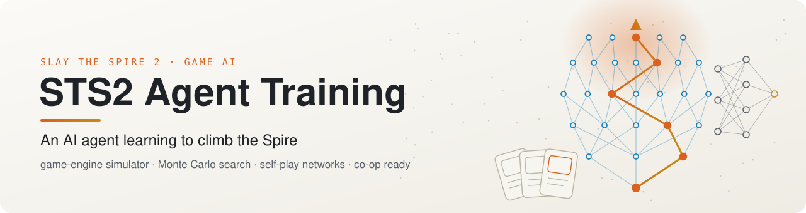

<p align="center">
  <picture>
    <source media="(prefers-color-scheme: dark)" srcset="assets/banner-dark.svg">
    
  </picture>
</p>

<p align="center">
  
  
  
  
  
</p>

<p align="center">
  <b>An AI agent that learns to play <i>Slay the Spire 2</i>, first solo as the Ironclad, then as a co-op teammate.</b>
</p>
<p align="center">
  It reads the real game through a state-export mod, plans with search over a simulator built on the game's own engine, and trains neural networks on its own play. Every claim is checked against results, not against how a human plays.
</p>

<p align="center">
  <a href="#in-one-minute">In one minute</a> ·
  <a href="#how-it-works">How it works</a> ·
  <a href="#results-so-far">Results</a> ·
  <a href="#roadmap">Roadmap</a> ·
  <a href="#repository-map">Repository map</a> ·
  <a href="#getting-started">Getting started</a>
</p>

---

## In one minute

<table>
<tr><td width="18%"><b>The goal</b></td><td>Clearly beat a human benchmark: the project owner's recorded Ironclad win rates of <b>63%</b> at Ascension 0–4, <b>25%</b> at 5–9 and <b>8%</b> at 10. Then play co-op alongside a human, controlling a second character.</td></tr>
<tr><td><b>The approach</b></td><td>Three layers that build on each other: <b>knowledge</b> from 57 recorded human runs and the game's data, a <b>simulator</b> that runs the game's real combat engine outside the game so the agent can search, and <b>learned models</b> trained by self-play inside that simulator.</td></tr>
<tr><td><b>The rules</b></td><td>Judged by outcomes, never by imitation. The agent only ever uses what a player can see on screen. Every comparison that decides anything is written down before it runs, and failed experiments stay in the record.</td></tr>
</table>

> **Current focus (since 2026-11-20): whole runs.** Fight play is now strong (wide search wins 99 of 120 benchmark fights), but runs are won or lost mostly by deck building, route and choices. Those decisions (Neow and Ancients, card rewards, removal, upgrades, shops, map route, events, boss relics, potions) are now the main training target, judged by whole simulated runs with search playing every fight. Plan: [decision 0004](docs/decisions/0004-whole-run-first.md). Results so far (2026-11-21): the hand-made deck rules lose to taking the first card and the route planner helps; choosing card rewards by playing each option forward over re-sampled futures beats the hand-made rules by 6.6 floors and gives the first act 2 boss wins. Against the strongest card rule known (taking the first card), the same rollouts still gain 5.5 floors and take 12 of 60 runs to the act 2 boss instead of 1. Map routes by the same method gain about one floor by avoiding elites, without more boss wins. At Ascension 10, the target, both together gain 2.8 floors, all by reaching the act 1 boss twice as often; they beat it in 1 fight of 10, against more than half for the human benchmark. That boss fight is now the main gap (3 wins in 99 fights). A test of giving the rollouts credit for progress against the boss turned out not to have applied the credit (a defect in the benchmark tool found on 2026-11-21, see below), so that idea is still untested. At Ascension 0 the agent wins none of 30 new runs, with bosses ending most of them. A [review](docs/reviews/2026-11-21-training-review.md) of these results found the main cause: the agent reaches bosses underpowered, not under-healed (it never drinks potions, upgrades Strikes, leaves its gold unspent and holds three relics where the human holds five), while its fight play matches the human's on the same situations. The direction from here ([decision 0005](docs/decisions/0005-a0-first-and-resource-use.md)): Ascension 0 first, every resource used, and rollouts judged by a model of the real fighter. The first test of that direction: with potions drunk in fights, upgrades put on real cards instead of Strikes, and shops open, the agent climbs 7 floors further at Ascension 0, beats the act 1 boss in 25 of 30 runs instead of 16 and wins its first whole run (1 of 30). It now dies in act 2, and it still leaves 500 gold unspent, so shops are the next gap. Removing the three one at a time points at potions: without them the agent is back where it started (6.8 floors lower), while the upgrade rule and shop purchases are each worth two to three floors that 30 runs cannot confirm. **Correction (2026-11-21):** the benchmark tool kept one arm's rollout settings for every arm a worker played. Three comparisons are touched: the boss-credit test compared a policy with itself, and in these two A0 comparisons the rollouts were played by an older rule set than registered, so the one-at-a-time differences are not clean. The numbers stand as measured; the corrections are in each report's section 6, and the tool is fixed. The shop code turned out to skip every shop entered with more than about 180 gold. The repair and events chosen by playing ahead were tested together on 30 new seeds (2026-11-22): events gain 2.9 floors (p = 0.03); the repaired shops spend the gold (210 left instead of 455) and get no further for it (+0.2 floors). The agent wins 4 of those 120 runs. Bosses end 82 of the 116 it loses, and beside the human's runs the reason is visible: the agent reaches the act 2 boss with 5.9 relics against 9.9 and 7.4 upgraded cards against 10.1, having fought half as many elites and kept the HP instead. A model of the real fighter inside the rollouts, meant to stop elites and bosses looking worse than they are, played 9.7 floors worse and is not used. On the corrected simulator (2026-11-22: chest relics reach the player) the agent holds about the human's relics and the last boss became the wall, so it comes first ([decision 0006](docs/decisions/0006-act-3-boss-first.md)). Since then a defect in the fight search against a three-form boss was found by a trace and fixed, and replaying the last boss with the project owner's decks showed that the decks and the fight play both lose it. The boss credit was tested at last (2026-11-23) and does not help. On new seeds the current policy wins about one run in ten at Ascension 0 (5 of 52), and the act 2 boss is not settled either. Traces of 122 boss fights (2026-11-23) then showed that the fight search had never compared the answers to a card choice made inside a fight (the card Headbutt puts back, the card True Grit exhausts, the Knowledge Demon's curse): it took the first option every time, and against the Knowledge Demon that is the curse the boss notes rank last. Community card tiers as a prior in card rewards were then read (2026-11-23): no gain in floors, but all 7 wins of that benchmark and every win against the last boss came from the two arms with the tiers; the registered rule counted floors, so the tiers stay out until that lead has its own test. The unchanged policy has now won 5 of 82 runs at Ascension 0. Under test now: the fight search with the card choices searched (fights; [boss replay 4](reports/phase9/boss-replay-4.md)).

<!-- auto:numbers:start -->
<table>
<tr>
<td align="center" width="25%"><h3>57</h3>human runs analysed<br><sub>deaths, damage per encounter, card picks</sub></td>
<td align="center" width="25%"><h3>11 / 11</h3>recorded fights replayed exactly<br><sub>by the simulator, every state equal</sub></td>
<td align="center" width="25%"><h3>+51</h3>value per fight from search<br><sub>best search (mcw6) over the rule planner, 120 games</sub></td>
<td align="center" width="25%"><h3>84,205</h3>self-play decisions<br><sub>from 4,435 simulated fights</sub></td>
</tr>
</table>
<!-- auto:numbers:end -->

## How it works

<p align="center">
  <picture>
    <source media="(prefers-color-scheme: dark)" srcset="assets/how-it-works-dark.svg">
    
  </picture>
</p>

1. **Knowledge.** The project owner's run history becomes a danger map (which fights cost HP and end runs), a benchmark to beat and a source of hypotheses. Game data and community strategy fill the gaps. The result is a versioned playbook plus rule-based tools: a turn planner that does exact damage and block arithmetic, a draft scorer, a path planner and a deck checker.
2. **Simulator.** A .NET host loads the game's own assemblies from a local installation and runs real combat, and whole runs, without the game's window, graphics or saves. It can start any fight from a situation taken from a real run, snapshot it, and re-sample everything a player cannot see (draw order, random rolls) before trying a move.
3. **Search.** For every distinct legal move (not only the moves the rule planner would pick), the agent samples several possible futures, plays each one out to the end of the fight and picks the move with the best average result.
4. **Learning.** Search plays thousands of fights; every decision, every candidate's value and every outcome is recorded. Networks learn to predict fight results and move values from what is visible, so that search can look wider for the same time, and a fast policy exists when time is short.

## Results so far

<p align="center">
  <picture>
    <source media="(prefers-color-scheme: dark)" srcset="assets/benchmark-dark.svg">
    
  </picture>
</p>

**Latest benchmark** (generated from the run manifests; every run plays the same 120 games):

<!-- auto:latest:start -->
| Policy | Fights won | Mean value | Time per move | Model | Run |
|---|---|---|---|---|---|
| Monte Carlo search, wide (`mcw6`) | 99 of 120 | -7.7 | 2.6 s | – | [`vsearch-5b`](data/learn/bench/vsearch-5b/manifest.json) 2026-11-21 |
| Search, wide with network filter (`mcwq6`) | 94 of 120 | -17.9 | 1.8 s | – | [`vsearch-5b`](data/learn/bench/vsearch-5b/manifest.json) 2026-11-21 |
| Monte Carlo search (`mc24`) | 89 of 120 | -26.1 | 3.5 s | – | [`budget-1`](data/learn/bench/budget-1/manifest.json) 2026-11-20 |
| Monte Carlo search (`mc6`) | 86 of 120 | -34.9 | 1.3 s | – | [`vsearch-5b`](data/learn/bench/vsearch-5b/manifest.json) 2026-11-21 |
| Monte Carlo search (`mc12`) | 85 of 120 | -32.6 | 1.8 s | – | [`budget-1`](data/learn/bench/budget-1/manifest.json) 2026-11-20 |
| Rule planner (`planner`) | 75 of 120 | -59.1 | 4 ms | – | [`vsearch-5b`](data/learn/bench/vsearch-5b/manifest.json) 2026-11-21 |
| Action-value network (`qpolicy`) | 74 of 120 | -56.9 | 11 ms | `q-v5` | [`vsearch-5b`](data/learn/bench/vsearch-5b/manifest.json) 2026-11-21 |
| Search with value network (`vleaf2`) | 70 of 120 | -64.5 | 234 ms | `value-v5` | [`vsearch-5b`](data/learn/bench/vsearch-5b/manifest.json) 2026-11-21 |
| Search with value network (`vleaf6`) | 68 of 120 | -67.0 | 469 ms | `value-v4` | [`vsearch-4`](data/learn/bench/vsearch-4/manifest.json) 2026-11-20 |
| Value network, one step (`vgreedy`) | 66 of 120 | -77.2 | 68 ms | `value-v4` | [`vsearch-4`](data/learn/bench/vsearch-4/manifest.json) 2026-11-20 |
<!-- auto:latest:end -->

<!-- auto:realruns:start -->
**Real game:** 2 full runs by the agent, 1 won (highest Ascension won: 0). Latest: 2026-11-20, Ascension 1, reached act 1 floor 17. Details in the [scoreboard](metrics/scoreboard.csv) and [run journals](runs/).
<!-- auto:realruns:end -->

**What has been established so far:**


| Area | Result | Evidence |
|---|---|---|
| **Simulator fidelity** | All 11 recorded fights replay with every state equal to the game's; a recorded 48-floor run matches 75 of 75 checks. Two defects of the same kind were found on 2026-11-22 outside what those checks covered (work the game's screens do, which the simulator has none of): a shop's card removal could be bought repeatedly, and **a relic picked from a chest never reached the player**. Both are fixed; every whole-run result below except the last (run benchmark 16) was played before the second fix, so its floors and wins are those of a harder game. | [fidelity](reports/phase7/fidelity.md) · [run fidelity](reports/phase7/run-fidelity.md) |
| **Whole runs** | A run starts from any seed and plays through every room type to the final boss (40 of 40 flow runs and 30 of 30 normal runs finish). | [flow](reports/phase7/whole-runs-flow.md) · [play](reports/phase7/whole-runs-play.md) |
| **Search in every fight of a run** | Each fight inside a simulated run is rebuilt in a second simulator from the run's own save at the start of the fight, with the unseen future re-sampled, and played by wide search: 26,747 moves over 180 runs, no state mismatch, 0.6% left to the rule planner (fights started by events). | [run benchmark 2](reports/phase9/run-bench-2.md) |
| **Deck building and route (A5, first test with search in every fight)** | The hand-made deck-building rules lose: 2.4 floors fewer than taking the first card of every reward (36 runs worse, 9 better), smaller decks that die in elites. The route planner wins back 2.7 floors (37 better, 15 worse, p = 0.002). No policy gets past the act 2 boss yet; the act 1 boss is the wall at A5. | [run benchmark 2](reports/phase9/run-bench-2.md) |
| **Copying a run, future unknown** | A run can be copied at any decision point and played forward with everything a player cannot see re-sampled (future encounters, events, rewards, later maps and bosses, relic order); checked for exact copies, repeatability and leaks. This lets each strategic option be judged by what tends to follow it. | [sampler story](docs/phase-7-engine-simulator.md) · [fair-play rules](docs/simulator-integrity.md) |
| **Card rewards by playing ahead (A5)** | Each card offer, skip included, is judged by copying the run, re-sampling the unknown future six times and playing every option to the end of the act. Against the hand-made draft rules: **+6.6 floors** (44 runs better, 7 worse, p < 10⁻⁷). Against taking the first card, the strongest card rule known: **+5.5 floors** (32 better, 8 worse, p < 10⁻⁴), act 1 boss beaten in 23 runs against 10, the act 2 boss reached in 12 against 1, two runs at the act 3 boss. Search played every move of every fight (no fallbacks). The rollouts favour attacks such as Anger, Twin Strike and Iron Wave. | [run benchmark 3](reports/phase9/run-bench-3.md) · [run benchmark 5](reports/phase9/run-bench-5.md) |
| **Map routes by playing ahead (A5)** | The same method for every fork of the map, against the route planner: +1.1 floors (22 runs better, 11 worse, p = 0.04, interval includes zero). The rollouts avoid elites (about one per run instead of two) and get more runs to the act 1 boss (55 against 46), but do not beat it more often; the rule planner that fights inside the rollouts undervalues what elites give for the boss. | [run benchmark 4](reports/phase9/run-bench-4.md) |
| **Playing ahead at Ascension 10** | Card rewards and map routes both by rollouts, against the first card and the route planner, at the target ascension: **+2.8 floors** (32 runs better, 7 worse, p < 10⁻⁴). Twice as many runs reach the act 1 boss (48 of 60 against 24), about as often as the human benchmark (76%), but they beat it in 5 of 48 fights against 12 of 19 for the human. The Kin was not beaten once in 19 fights. | [run benchmark 6](reports/phase9/run-bench-6.md) |
| **Whole new runs at Ascension 0** | A first win-rate measurement: 30 complete new runs, every decision the agent's own (card and route rollouts, search in every fight, rules elsewhere). **0 wins** (interval 0–11%), against 5 of 8 for the human benchmark at A0–4. Every run reaches the act 1 boss and 60% beat it; bosses end 21 of the 30 runs, in all three acts, and 462 gold per run goes unspent because the agent does not shop yet. | [run benchmark 8](reports/phase9/run-bench-8.md) |
| **Using potions, upgrades and shops (A0)** | The same runs with potions used by the fight search, a rest rule that upgrades real cards unless HP is low, and shop purchases judged by playing ahead: **+7.0 floors** (21 runs better, 4 worse, p = 0.0005). The act 1 boss falls in 25 of 30 runs (16 of 29 before), the act 2 boss in 6 of 15 (1 of 8), and one run in 30 wins. Runs now end in act 2. Shops still buy about one card per run and 503 gold is left over. The arm's card and route rollouts were played by the old rules, not with potions and the new rest rule as registered (section 6). | [run benchmark 11](reports/phase9/run-bench-11.md) |
| **Which of the three carries it (A0)** | Each component removed in turn on the same 30 seeds. Without potions: **−6.8 floors** (p = 0.011), back to the level before all three. Without the upgrade rule: −2.2 floors (p = 0.20); the act 2 boss falls in 1 of 14 fights instead of 6 of 15. Without shop purchases: −3.0 floors (p = 0.50). All three stay. Each comparison carries a second difference (rollouts played by different rule sets; section 6), so none is a clean test. | [run benchmark 12](reports/phase9/run-bench-12.md) |
| **Shops and events by playing ahead (A0)** | Two factors on 30 new seeds, four policies each. Events, Neow and the Ancients chosen by rollouts: **+2.9 floors** (17 seeds better, 7 worse, p = 0.03). Every affordable shop item judged by rollouts: the agent now spends its gold (210 left instead of 455; 2.3 cards, 0.6 relics and 0.9 removals bought per run) and gets no further for it (+0.2 floors, p = 0.50). **4 wins in 120 runs.** Bosses end 82 of the 116 lost runs, the act 2 boss alone 41. Beside the human's runs the agent reaches the act 2 boss with 5.9 relics against 9.9 and 7.4 upgraded cards against 10.1, after half as many elites. | [run benchmark 15](reports/phase9/run-bench-15.md) |
| **A learned fight model inside rollouts (A0)** | Negative. Instead of playing each fight inside a rollout with the rule planner, a network trained on 6,736 search fights gave the chance of winning and the HP left. On 29 seeds this plays **9.7 floors worse** (21 seeds worse, 6 better), and worse again when the rollouts go on to the end of the run (−14.6). The model's policies walk into ordinary fights nearly dead (14 and 12 of 29 runs die in one, against 4), and on a thirtieth seed one of them had stripped its deck of every attack and could not end a fight (helped by a simulator defect found through that run and fixed since: a shop's card removal could be bought more than once). On the fights of this benchmark the model does not beat per-encounter base rates (elites: AUC 0.55 against 0.75): it learned from decks that other rollouts had built and is wrong on the ones its own choices lead to. The policy without it reached floor 36.0 on average, beat the act 1 boss in 28 of 29 runs and won 1, the best so far. | [run benchmark 18](reports/phase9/run-bench-18.md) |
| **First runs on the corrected simulator: routes and a shop rule (A0)** | Two factors on 26 seeds, four policies each, on the simulator where chest relics reach the player. Map moves by rollouts against the route planner: +0.9 floors (11 seeds better, 11 worse, p = 0.58). A shop rule that buys relics inside rollouts: +1.5 floors (12 and 12, p = 0.58). Neither is established; the two interact (rollout routes are 3.2 floors behind the planner without the shop rule and 5.0 ahead with it). **8 wins in 104 runs** (7.7%, interval 4–14%); the best policy wins 4 of 26. With chest relics the agent now holds 9.0 relics at the act 2 boss against the human's 9.9 (5.9 before the fix) and beats it in 73% of the fights (45%). The act 3 boss is the wall: 8 of 42 fights won (Queen 0 of 9, Test Subject 3 of 24), where the human wins 13 of 15 with a similar deck size, HP and relic count; it ends 34 of the 96 lost runs. | [run benchmark 16](reports/phase9/run-bench-16.md) |
| **A defect in the fight search against a three-form boss (A0)** | Found by replaying one lost fight with every decision's values kept, not by a statistic: a lost playout was scored by the HP of the boss form then alive, so dying in the first form looked better than dying in the second, and the search avoided killing the first form. With the forms still to come counted, the search removes 70% of the three forms' HP against 31% (27 situations; 24 better, 2 worse, p < 10⁻⁵) and wins 6 fights against 2; with the project owner's own decks 4 of 12 against 0 of 12. On by default since. Wins stay rare with the agent's decks (2 of 23), and with the owner's decks the search still wins a third of fights he won every time: decks and fight play both remain to be improved. | [boss replay 2](reports/phase9/boss-replay-2.md) |
| **Decks or fight play at the last boss? Both (A0)** | The same fight search was given the project owner's 15 recorded situations at the last boss, at Ascension 0, beside the agent's own 42. It wins **8 of 15 on the first seeds against the agent's 8 of 42 in its runs** (p = 0.016), 24 of 45 over three seeds as the runs play now, and 5 of 40 with the agent's decks: against the Queen 10 of 18 with his decks and 0 of 9 with the agent's, with nothing changed in the search. So the decks are a cause on their own. Fight play is the other: at the ascensions he played, the search wins 18 of 45 with his decks where he won 13 of 15. A second option for the search (not counting a minion's HP in a lost playout) won 9 fights against 10 and stays off. | [boss replay 2](reports/phase9/boss-replay-2.md) |
| **A second correction of the fight search that did not hold (A0)** | Traces of 22 lost fights against the same boss showed 31% of turns ended with a playable card left that the energy paid for, by margins inside the noise of six sampled playouts. The registered correction (play the rule planner's next card unless ending the turn is clearly better) was tried on fresh seeds of 27 situations: 71% of the boss's HP removed against 70%, 11 fights won against 9 of 35, neither significant. Not adopted. It fired about once a fight, so the planner mostly ends those turns itself; that is traced next. | [boss replay 3](reports/phase9/boss-replay-3.md) |
| **Credit for hurting a boss in the playouts behind strategic choices (A0)** | Negative. A playout that died in a boss fight was credited with the share of the boss's HP it removed, so that decks which nearly kill a boss stop looking the same as decks that do not scratch it. It did what it was built to do (decisions where every option scores the same fell from 8.8% to 3.6%) and the runs did not climb: **−0.6 floors** on 26 seeds (7 better, 10 worse, p = 0.83), one win each. Not adopted. The same run is the first check of the previous benchmark's best policy on new seeds: 1 win in 26 where it had 4 in 26, **5 of 52** together (interval 4–21%), so the current level is about one run in ten. On these seeds the act 2 boss is beaten in 19 of 43 fights (56 of 77 on the earlier seeds; Kaiser Crab 6 of 18) and ends more runs than the last boss again. | [run benchmark 17](reports/phase9/run-bench-17.md) |
| **Community card tiers as a prior in card rewards (A0)** | Mixed, and not adopted. Among card-reward options the playouts cannot tell apart, the card that the community tier table rates higher is taken (tie-break), or the 15 cards every source rates lowest are left out from act 2 on (hard filter). Floors did not rise: **−0.9 and −1.8 floors** on 30 seeds (p = 0.70 and 0.97). Wins went the other way: the two arms won **3 and 4 runs of 30, the unchanged policy none** (p = 0.13 and 0.06), and only they beat the last boss (7 fights of 31 against 0 of 16), with decks closer to the project owner's (half the lowest-tier cards, fewer attacks, more skills), while losing a little more often at the act 2 boss. A won run and a run lost to the last boss end on the same floor, so the registered rule, which counted floors, could not see this; by that rule neither enters, and the lead gets a test of its own. The unchanged policy over three benchmarks: 5 wins in 82 runs (interval 3–13%). | [run benchmark 20](reports/phase9/run-bench-20.md) |
| **Speed** | About 32 fights per second per core; restoring a snapshot takes 4 ms at the median (longer late in long fights, since the moves since the start are replayed). | [spike report](reports/phase7/spike.md) |
| **Fair play** | 8 of 8 checks pass: the hidden draw order changes with the sample seed, the true next draws are guessed no better than chance, and decisions do not depend on hidden state. | [integrity rules](docs/simulator-integrity.md) |
| **Search against rules** | Monte Carlo search over **every distinct legal move** wins **99 of 120** benchmark games against 75 for the rule planner (+51 value per fight, better in 90 games, worse in 20). Limited to the planner's own candidate moves, the same search wins 86 (+24). | [wide candidates](reports/phase8/wide-candidates.md) · [comparison](reports/phase9/value-search-comparison-2.md) |
| **Fast learned policy** | Not established. The action-value network wins 74 of 120 against 75 for the planner (`q-v5`, +2 value per fight; `q-v4` had 81) at 10 ms per move. Used as a filter that cuts wide search to 4 candidates, it saves 30% of search time but loses 10 value per fight, mostly in elites. | [comparison 4](reports/phase9/value-search-comparison-4.md) · [comparison 5](reports/phase9/value-search-comparison-5.md) |
| **Learned evaluation** | Not there yet, but closing in. Four pre-registered tests of the value network inside search failed, each by less: search with network leaves went from −54 to −32 value per fight against rollout search. The first networks memorised their training runs; augmented situations and set dropout fixed most of that (held-out error 64 → 40, level with a linear model). | [test 1](reports/phase9/value-search-comparison.md) · [test 4](reports/phase9/value-search-comparison-4.md) |
| **Search budget** | Which moves are searched matters far more than how many futures are sampled: widening the candidates added 27 value per fight at twice the time, while four times the futures added about 9. | [budget](reports/phase8/search-budget.md) |
| **Boss fights** | On the ten boss fights of the benchmark (six seeds each), wide search wins 4.2 on average with 24 futures per move and 3.5 with 6; the project owner won 4 of the 10 in the real runs. Search wins two the human lost and loses two the human won with three potions in hand. On the 98 boss fights the agent's own Ascension 10 runs reach, twice the search budget does not help either (11 wins against 15) while search is far ahead of the rule planner (9 wins): the decks limit those fights, not the search. | [boss study](reports/phase8/boss-budget.md) · [boss replay](reports/phase9/boss-replay-1.md) |
| **Potions in search** | Not established: +7 value per fight with the planner's candidates and +3 with wide search, neither significant; offering every usable potion made search drink 77 potions in 120 fights and end 4.5 lower once potions are priced. When to drink is now treated as a run-level question. | [first test](reports/phase8/potions-in-search.md) · [wide search](reports/phase8/potions-wide.md) · [every potion](reports/phase8/potions-all.md) |

*Value is the search's own score: HP left after a win, or −100 minus the enemies' HP left after a loss. Negative results are kept on purpose: they explain what changed next.*

## Roadmap

<!-- auto:roadmap:start -->
| Phase | What it delivers | State |
|:---:|---|:---:|
| **0** | Setup: game version, mods (security-reviewed), save safety, live interface | ◐ |
| **1** | History analysis: encounter danger, deaths, card choices, playbook v1 | ● |
| **2** | Knowledge base: mechanics, enemies, bosses, community strategy | ◐ |
| **3** | Shadowing: the agent calls each decision before the human makes it | ◐ |
| **4** | Solo practice: full runs in the real game, journals and post-mortems | ◐ |
| **5** | Second character (Necrobinder) | ◐ |
| **6** | Co-op: the agent as a teammate controlling its own character | ◐ |
| **7** | Engine simulator: the game's combat and whole runs in our own process | ◐ |
| **8** | Combat search and autopilot | ◐ |
| **9** | Learned models and reinforcement learning | ◐ |
<!-- auto:roadmap:end -->

● done · ◐ in progress · ○ not started. Milestones reached so far: **first solo win (A0)** and **engine running in our own process**. Next: learned evaluation that beats rollouts, a combat autopilot for real runs, the Ascension ladder to A10, and co-op. The detailed plan, with epics and acceptance criteria, is in [TRAINING_PLAN.md](TRAINING_PLAN.md) and [docs/](docs/README.md); live progress is on the [status board](docs/STATUS.md).

## Fair play and safety

- **Only what a player can see.** No seeds, random-generator states, draw order or future intents ever reach a decision. Search restores the past and re-samples the hidden future.
- **No debug modes.** The game's test mode is never switched on globally; display-only code is bypassed in a few named places, each justified in [the integrity rules](docs/simulator-integrity.md).
- **Sandboxed.** The simulator runs with an empty home folder, never writes saves, never touches achievements, Steam or telemetry, and opens no network connection (checked automatically).
- **Reviewed dependencies.** Downloaded code (mods, the learning framework) is security-reviewed before it is built or run; Python packages are pinned by hash.

## Repository map

| Folder | What is inside |
|---|---|
| [`sim/`](sim/) | .NET 9 host that runs the game's combat engine: Harmony patches, a fake engine layer, a JSON-lines server |
| [`tools/`](tools/) | Python tools: game interface, history analysis, turn planner, drafting, pathing, self-play, simulator bridge |
| [`tools/learn/`](tools/learn/) | observation encoder, value and action-value networks, training, paired benchmark runner |
| [`knowledge/`](knowledge/) | game mechanics, enemies, bosses, cards and community strategy; data tables checked against the game |
| [`playbooks/`](playbooks/) | strategy per character, versioned, with a one-page quick reference |
| [`reports/`](reports/) | analyses and experiment write-ups by phase: history, simulator, search, learning |
| [`docs/`](docs/) | phase plans with epics and stories, status board, runbooks, decisions, security reviews |
| [`data/`](data/) | fixed benchmark sets and dataset manifests (raw data and run history stay local) |
| [`models/`](models/) | model cards and training records (weights are not stored in git) |
| [`runs/`](runs/) | journals, decisions and post-mortems of the agent's real runs |
| [`templates/`](templates/) | journal, post-mortem and pre-registered comparison templates |

## Getting started

You need your own copy of *Slay the Spire 2* (installed through Steam on macOS), the .NET 9 SDK and Python 3.13. Nothing from the game is included here: the simulator reads the game's assemblies from your installation at run time.

```bash
# point the build at your installed game (default Steam location on macOS)
export STS2_DATA_DIR="$HOME/Library/Application Support/Steam/steamapps/common/\
Slay the Spire 2/SlayTheSpire2.app/Contents/Resources/data_sts2_macos_arm64"
(cd sim && dotnet build -c Release)

# check it: a fight from nothing, fair play, sandbox
python3 -I tools/sim.py smoke
python3 -I tools/sim.py fairplay
python3 -I tools/sim.py sandbox
```

Self-play and training (fight situations come from your own run history via `tools/extract_runs.py` and `tools/fight_specs.py`; the learning tools run in a virtual environment built from the hash-pinned `requirements-learn.txt`):

```bash
# self-play: the search plays every situation and records each decision
python3 -I tools/selfplay.py --workers 6 --fights 586 \
    --specs data/learn/specs/fight-specs-ironclad.json --out data/learn/combat-v1

# train a value network, then compare policies on the benchmark
.venv-learn/bin/python -I tools/learn/train_value.py --data data/learn/combat-v1 --name value-v1
.venv-learn/bin/python -I tools/learn/bench.py --out data/learn/bench/run-1 \
    --arms planner mc6 vleaf6 --model models/value-v1/model.pt
```

Every tool has a docstring with its options; [tools/README.md](tools/README.md) lists them by purpose.

## How experiments are run

Each decision-relevant comparison follows [a fixed template](templates/comparison.md): hypotheses, fights, policies, metric, statistical test and *what follows from each outcome* are committed before the run, and corrections afterwards go into a separate section. Fights are paired (same fight, same seeds, same machine load), tested with a one-sided sign test and a bootstrap interval, and the benchmark's fights never enter training data.

## Disclaimer

A fan-made research project, not affiliated with or endorsed by Mega Crit. *Slay the Spire* is a trademark of Mega Crit Games. No game files, art, text dumps or decompiled data are distributed in this repository.

<!-- auto:updated:start -->
<sub>Generated sections last refreshed 2026-11-21 · game v0.111.1 · `python3 -I tools/update_readme.py`</sub>
<!-- auto:updated:end -->
