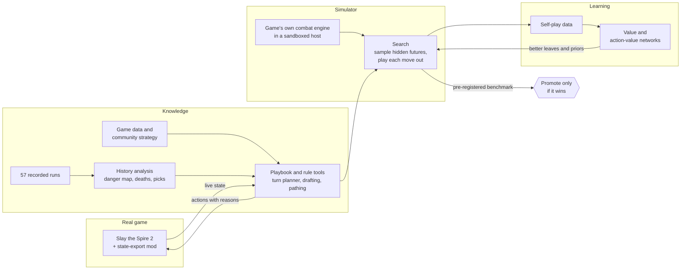
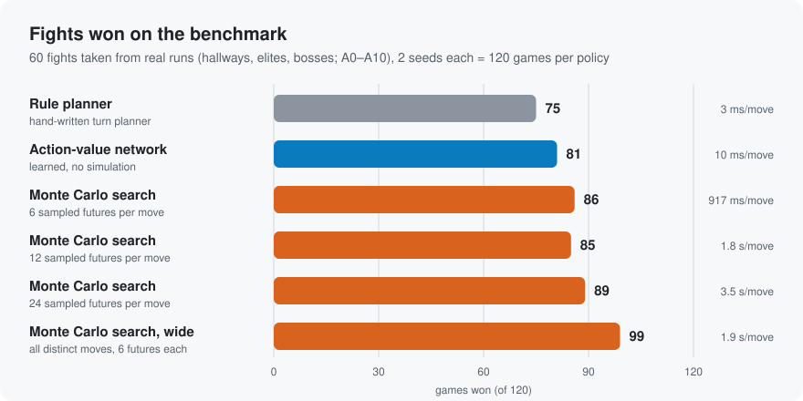

<p align="center">
  <picture>
    <source media="(prefers-color-scheme: dark)" srcset="assets/banner-dark.svg">
    
  </picture>
</p>

<p align="center">
  
  
  
  
  
</p>

<p align="center">
  <b>An AI agent that learns to play <i>Slay the Spire 2</i>, first solo as the Ironclad, then as a co-op teammate.</b><br>
  It reads the real game through a state-export mod, plans with search over a simulator built on the game's own engine,<br>
  and trains neural networks on its own play. Every claim is checked against results, not against how a human plays.
</p>

<p align="center">
  <a href="#in-one-minute">In one minute</a> ·
  <a href="#how-it-works">How it works</a> ·
  <a href="#results-so-far">Results</a> ·
  <a href="#roadmap">Roadmap</a> ·
  <a href="#repository-map">Repository map</a> ·
  <a href="#getting-started">Getting started</a>
</p>

---

## In one minute

| | |
|---|---|
| **The goal** | Clearly beat a human benchmark: the project owner's recorded Ironclad win rates of **63%** at Ascension 0–4, **25%** at 5–9 and **8%** at 10. Then play co-op alongside a human, controlling a second character. |
| **The approach** | Three layers that build on each other: **knowledge** from 57 recorded human runs and the game's data, a **simulator** that runs the game's real combat engine outside the game so the agent can search, and **learned models** trained by self-play inside that simulator. |
| **The rules** | Judged by outcomes, never by imitation. The agent only ever uses what a player can see on screen. Every comparison that decides anything is written down before it runs, and failed experiments stay in the record. |

<table>
<tr>
<td align="center" width="25%"><h3>57</h3>human runs analysed<br><sub>deaths, damage per encounter, card picks</sub></td>
<td align="center" width="25%"><h3>11 / 11</h3>recorded fights replayed exactly<br><sub>by the simulator, every state equal</sub></td>
<td align="center" width="25%"><h3>+24</h3>value per fight from search<br><sub>over the rule planner, 120 paired games</sub></td>
<td align="center" width="25%"><h3>21,968</h3>self-play decisions<br><sub>from 586 situations of real runs</sub></td>
</tr>
</table>

## How it works



1. **Knowledge.** The project owner's run history becomes a danger map (which fights cost HP and end runs), a benchmark to beat and a source of hypotheses. Game data and community strategy fill the gaps. The result is a versioned playbook plus rule-based tools: a turn planner that does exact damage and block arithmetic, a draft scorer, a path planner and a deck checker.
2. **Simulator.** A .NET host loads the game's own assemblies from a local installation and runs real combat, and whole runs, without the game's window, graphics or saves. It can start any fight from a situation taken from a real run, snapshot it, and re-sample everything a player cannot see (draw order, random rolls) before trying a move.
3. **Search.** For each candidate move, the agent samples several possible futures, plays each one out to the end of the fight and picks the move with the best average result.
4. **Learning.** Search plays thousands of fights; every decision, every candidate's value and every outcome is recorded. Networks learn to predict fight results and move values from what is visible, so that search can look wider for the same time, and a fast policy exists when time is short.

## Results so far

<p align="center">
  <picture>
    <source media="(prefers-color-scheme: dark)" srcset="assets/benchmark-dark.svg">
    
  </picture>
</p>

| Area | Result | Evidence |
|---|---|---|
| **Simulator fidelity** | All 11 recorded fights replay with every state equal to the game's; a recorded 48-floor run matches 71 of 71 checks. | [fidelity](reports/phase7/fidelity.md) · [run fidelity](reports/phase7/run-fidelity.md) |
| **Whole runs** | A run starts from any seed and plays through every room type to the final boss (40 of 40 flow runs and 30 of 30 normal runs finish). | [flow](reports/phase7/whole-runs-flow.md) · [play](reports/phase7/whole-runs-play.md) |
| **Speed** | About 32 fights per second per core; restoring a snapshot takes 4 ms at the median (longer late in long fights, since the moves since the start are replayed). | [spike report](reports/phase7/spike.md) |
| **Fair play** | 8 of 8 checks pass: the hidden draw order changes with the sample seed, the true next draws are guessed no better than chance, and decisions do not depend on hidden state. | [integrity rules](docs/simulator-integrity.md) |
| **Search against rules** | Monte Carlo search beats the rule planner by **24 value points per fight**: better in 75 of 120 paired games, worse in 21; 86 wins against 75. | [comparison](reports/phase9/value-search-comparison-2.md) |
| **Fast learned policy** | The action-value network (`q-v2`) plays level with the planner (78 wins against 75, not significant) at 7 ms per move with no simulation at all. | [comparison](reports/phase9/value-search-comparison-2.md) |
| **Learned evaluation** | Not there yet. Three pre-registered tests of the value network inside search failed; the diagnosis is that it memorises the roughly thirty training runs. Data augmentation and set dropout are the current fix. | [test 1](reports/phase9/value-search-comparison.md) · [test 3](reports/phase9/value-search-comparison-3.md) |
| **Potions in search** | Promising but not established: +7 value per fight after pricing each potion, interval −0.2 to +15.8. | [comparison](reports/phase8/potions-in-search.md) |
| **Real game** | Two full runs by the agent in the real game: a win at Ascension 0 and a loss to the Act 1 boss at Ascension 1. | [runs](runs/) · [scoreboard](metrics/scoreboard.csv) |

*Value is the search's own score: HP left after a win, or −100 minus the enemies' HP left after a loss. Negative results are kept on purpose: they explain what changed next.*

## Roadmap

| Phase | What it delivers | State |
|:---:|---|:---:|
| **0** | Setup: game version, mods (security-reviewed), save safety, live interface | ◐ |
| **1** | History analysis: encounter danger, deaths, card choices, playbook v1 | ● |
| **2** | Knowledge base: mechanics, enemies, bosses, community strategy | ◐ |
| **3** | Shadowing: the agent calls each decision before the human makes it | ◐ |
| **4** | Solo practice: full runs in the real game, journals and post-mortems | ◐ |
| **5** | Second character (Necrobinder) | ◐ |
| **6** | Co-op: the agent as a teammate controlling its own character | ◐ |
| **7** | Engine simulator: the game's combat and whole runs in our own process | ◐ |
| **8** | Combat search and autopilot | ◐ |
| **9** | Learned models and reinforcement learning | ◐ |

● done · ◐ in progress · ○ not started. Milestones reached so far: **first solo win (A0)** and **engine running in our own process**. Next: learned evaluation that beats rollouts, a combat autopilot for real runs, the Ascension ladder to A10, and co-op. The detailed plan, with epics and acceptance criteria, is in [TRAINING_PLAN.md](TRAINING_PLAN.md) and [docs/](docs/README.md); live progress is on the [status board](docs/STATUS.md).

## Fair play and safety

- **Only what a player can see.** No seeds, random-generator states, draw order or future intents ever reach a decision. Search restores the past and re-samples the hidden future.
- **No debug modes.** The game's test mode is never switched on globally; display-only code is bypassed in a few named places, each justified in [the integrity rules](docs/simulator-integrity.md).
- **Sandboxed.** The simulator runs with an empty home folder, never writes saves, never touches achievements, Steam or telemetry, and opens no network connection (checked automatically).
- **Reviewed dependencies.** Downloaded code (mods, the learning framework) is security-reviewed before it is built or run; Python packages are pinned by hash.

## Repository map

```text
sim/          .NET 9 host that runs the game's combat engine (Harmony patches, fake engine layer, JSON-lines server)
tools/        Python tools: game interface, analysis, turn planner, drafting, pathing, self-play, simulator bridge
tools/learn/  observation encoder, value and action-value networks, training, paired benchmark runner
knowledge/    game mechanics, enemies, bosses, cards, community strategy, data tables checked against the game
playbooks/    strategy per character, versioned, with a one-page quick reference
reports/      analyses and experiment write-ups by phase (history, simulator, search, learning)
docs/         phase plans with epics and stories, status board, runbooks, decisions, reviews
data/         fixed benchmark sets and dataset manifests (raw data and run history stay local)
models/       model cards and training records (weights are not stored in git)
runs/         journals, decisions and post-mortems of the agent's real runs
templates/    journal, post-mortem and pre-registered comparison templates
```

## Getting started

You need your own copy of *Slay the Spire 2* (installed through Steam on macOS), the .NET 9 SDK and Python 3.13. Nothing from the game is included here: the simulator reads the game's assemblies from your installation at run time.

```bash
# build the simulator host against your installed game
cd sim && STS2_DATA_DIR="$HOME/Library/Application Support/Steam/steamapps/common/Slay the Spire 2/SlayTheSpire2.app/Contents/Resources/data_sts2_macos_arm64" dotnet build -c Release && cd ..

# check it: a fight from nothing, fair play, sandbox
python3 -I tools/sim.py smoke
python3 -I tools/sim.py fairplay
python3 -I tools/sim.py sandbox
```

Self-play and training (fight situations come from your own run history via `tools/extract_runs.py` and `tools/fight_specs.py`; the learning tools run in a virtual environment built from the hash-pinned `requirements-learn.txt`):

```bash
python3 -I tools/selfplay.py --workers 6 --fights 586 --specs data/learn/specs/fight-specs-ironclad.json --out data/learn/combat-v1
.venv-learn/bin/python -I tools/learn/train_value.py --data data/learn/combat-v1 --name value-v1
.venv-learn/bin/python -I tools/learn/bench.py --out data/learn/bench/run-1 --arms planner mc6 qpolicy --q-model models/q-v1/model.pt
```

Every tool has a docstring with its options; [tools/README.md](tools/README.md) lists them by purpose.

## How experiments are run

Each decision-relevant comparison follows [a fixed template](templates/comparison.md): hypotheses, fights, policies, metric, statistical test and *what follows from each outcome* are committed before the run, and corrections afterwards go into a separate section. Fights are paired (same fight, same seeds, same machine load), tested with a one-sided sign test and a bootstrap interval, and the benchmark's fights never enter training data.

## Disclaimer

A fan-made research project, not affiliated with or endorsed by Mega Crit. *Slay the Spire* is a trademark of Mega Crit Games. No game files, art, text dumps or decompiled data are distributed in this repository.
