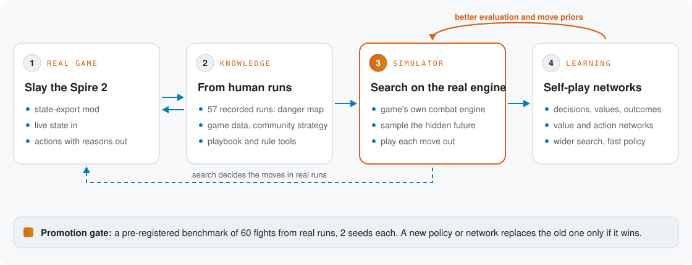

<p align="center">
  <picture>
    <source media="(prefers-color-scheme: dark)" srcset="assets/banner-dark.svg">
    
  </picture>
</p>

<p align="center">
  
  
  
  
  
</p>

<p align="center">
  <b>An AI agent that learns to play <i>Slay the Spire 2</i>, first solo as the Ironclad, then as a co-op teammate.</b>
</p>
<p align="center">
  It reads the real game through a state-export mod, plans with search over a simulator built on the game's own engine, and trains neural networks on its own play. Every claim is checked against results, not against how a human plays.
</p>

<p align="center">
  <a href="#in-one-minute">In one minute</a> ·
  <a href="#how-it-works">How it works</a> ·
  <a href="#results-so-far">Results</a> ·
  <a href="#roadmap">Roadmap</a> ·
  <a href="#repository-map">Repository map</a> ·
  <a href="#getting-started">Getting started</a>
</p>

---

## In one minute

<table>
<tr><td width="18%"><b>The goal</b></td><td>Clearly beat a human benchmark: the project owner's recorded Ironclad win rates of <b>63%</b> at Ascension 0–4, <b>25%</b> at 5–9 and <b>8%</b> at 10. Then play co-op alongside a human, controlling a second character.</td></tr>
<tr><td><b>The approach</b></td><td>Three layers that build on each other: <b>knowledge</b> from 57 recorded human runs and the game's data, a <b>simulator</b> that runs the game's real combat engine outside the game so the agent can search, and <b>learned models</b> trained by self-play inside that simulator.</td></tr>
<tr><td><b>The rules</b></td><td>Judged by outcomes, never by imitation. The agent only ever uses what a player can see on screen. Every comparison that decides anything is written down before it runs, and failed experiments stay in the record.</td></tr>
</table>

<!-- auto:numbers:start -->
<table>
<tr>
<td align="center" width="25%"><h3>57</h3>human runs analysed<br><sub>deaths, damage per encounter, card picks</sub></td>
<td align="center" width="25%"><h3>11 / 11</h3>recorded fights replayed exactly<br><sub>by the simulator, every state equal</sub></td>
<td align="center" width="25%"><h3>+51</h3>value per fight from search<br><sub>best search (mcw6) over the rule planner, 120 games</sub></td>
<td align="center" width="25%"><h3>64,534</h3>self-play decisions<br><sub>from 3,516 simulated fights</sub></td>
</tr>
</table>
<!-- auto:numbers:end -->

## How it works

<p align="center">
  <picture>
    <source media="(prefers-color-scheme: dark)" srcset="assets/how-it-works-dark.svg">
    
  </picture>
</p>

1. **Knowledge.** The project owner's run history becomes a danger map (which fights cost HP and end runs), a benchmark to beat and a source of hypotheses. Game data and community strategy fill the gaps. The result is a versioned playbook plus rule-based tools: a turn planner that does exact damage and block arithmetic, a draft scorer, a path planner and a deck checker.
2. **Simulator.** A .NET host loads the game's own assemblies from a local installation and runs real combat, and whole runs, without the game's window, graphics or saves. It can start any fight from a situation taken from a real run, snapshot it, and re-sample everything a player cannot see (draw order, random rolls) before trying a move.
3. **Search.** For every distinct legal move (not only the moves the rule planner would pick), the agent samples several possible futures, plays each one out to the end of the fight and picks the move with the best average result.
4. **Learning.** Search plays thousands of fights; every decision, every candidate's value and every outcome is recorded. Networks learn to predict fight results and move values from what is visible, so that search can look wider for the same time, and a fast policy exists when time is short.

## Results so far

<p align="center">
  <picture>
    <source media="(prefers-color-scheme: dark)" srcset="assets/benchmark-dark.svg">
    
  </picture>
</p>

**Latest benchmark** (generated from the run manifests; every run plays the same 120 games):

<!-- auto:latest:start -->
| Policy | Fights won | Mean value | Time per move | Model | Run |
|---|---|---|---|---|---|
| Monte Carlo search, wide (`mcw6`) | 99 of 120 | -7.7 | 1.9 s | – | [`potions-wide-1`](data/learn/bench/potions-wide-1/manifest.json) 2026-11-20 |
| Monte Carlo search (`mc24`) | 89 of 120 | -26.1 | 3.5 s | – | [`budget-1`](data/learn/bench/budget-1/manifest.json) 2026-11-20 |
| Monte Carlo search (`mc6`) | 86 of 120 | -34.9 | 917 ms | – | [`vsearch-4`](data/learn/bench/vsearch-4/manifest.json) 2026-11-20 |
| Monte Carlo search (`mc12`) | 85 of 120 | -32.6 | 1.8 s | – | [`budget-1`](data/learn/bench/budget-1/manifest.json) 2026-11-20 |
| Action-value network (`qpolicy`) | 81 of 120 | -50.3 | 10 ms | `q-v4` | [`vsearch-4`](data/learn/bench/vsearch-4/manifest.json) 2026-11-20 |
| Rule planner (`planner`) | 75 of 120 | -59.1 | 3 ms | – | [`vsearch-4`](data/learn/bench/vsearch-4/manifest.json) 2026-11-20 |
| Search with value network (`vleaf2`) | 73 of 120 | -63.0 | 181 ms | `value-v4` | [`vsearch-4`](data/learn/bench/vsearch-4/manifest.json) 2026-11-20 |
| Search with value network (`vleaf6`) | 68 of 120 | -67.0 | 469 ms | `value-v4` | [`vsearch-4`](data/learn/bench/vsearch-4/manifest.json) 2026-11-20 |
| Value network, one step (`vgreedy`) | 66 of 120 | -77.2 | 68 ms | `value-v4` | [`vsearch-4`](data/learn/bench/vsearch-4/manifest.json) 2026-11-20 |
<!-- auto:latest:end -->

<!-- auto:realruns:start -->
**Real game:** 2 full runs by the agent, 1 won (highest Ascension won: 0). Latest: 2026-11-20, Ascension 1, reached act 1 floor 17. Details in the [scoreboard](metrics/scoreboard.csv) and [run journals](runs/).
<!-- auto:realruns:end -->

**What has been established so far:**


| Area | Result | Evidence |
|---|---|---|
| **Simulator fidelity** | All 11 recorded fights replay with every state equal to the game's; a recorded 48-floor run matches 71 of 71 checks. | [fidelity](reports/phase7/fidelity.md) · [run fidelity](reports/phase7/run-fidelity.md) |
| **Whole runs** | A run starts from any seed and plays through every room type to the final boss (40 of 40 flow runs and 30 of 30 normal runs finish). | [flow](reports/phase7/whole-runs-flow.md) · [play](reports/phase7/whole-runs-play.md) |
| **Speed** | About 32 fights per second per core; restoring a snapshot takes 4 ms at the median (longer late in long fights, since the moves since the start are replayed). | [spike report](reports/phase7/spike.md) |
| **Fair play** | 8 of 8 checks pass: the hidden draw order changes with the sample seed, the true next draws are guessed no better than chance, and decisions do not depend on hidden state. | [integrity rules](docs/simulator-integrity.md) |
| **Search against rules** | Monte Carlo search over **every distinct legal move** wins **99 of 120** benchmark games against 75 for the rule planner (+51 value per fight, better in 90 games, worse in 20). Limited to the planner's own candidate moves, the same search wins 86 (+24). | [wide candidates](reports/phase8/wide-candidates.md) · [comparison](reports/phase9/value-search-comparison-2.md) |
| **Fast learned policy** | The action-value network (`q-v4`) wins 81 of 120 against 75 for the planner (+9 value per fight, not yet significant) at 10 ms per move, with no simulation at all. | [comparison](reports/phase9/value-search-comparison-4.md) |
| **Learned evaluation** | Not there yet, but closing in. Four pre-registered tests of the value network inside search failed, each by less: search with network leaves went from −54 to −32 value per fight against rollout search. The first networks memorised their training runs; augmented situations and set dropout fixed most of that (held-out error 64 → 40, level with a linear model). | [test 1](reports/phase9/value-search-comparison.md) · [test 4](reports/phase9/value-search-comparison-4.md) |
| **Search budget** | Which moves are searched matters far more than how many futures are sampled: widening the candidates added 27 value per fight at twice the time, while four times the futures added about 9. | [budget](reports/phase8/search-budget.md) |
| **Boss fights** | On the ten boss fights of the benchmark (six seeds each), wide search wins 4.2 on average with 24 futures per move and 3.5 with 6; the project owner won 4 of the 10 in the real runs. Search wins two the human lost and loses two the human won with three potions in hand. | [boss study](reports/phase8/boss-budget.md) |
| **Potions in search** | Not established: +7 value per fight with the planner's candidates and +3 with wide search, neither significant. Potions help in elite fights (95% won at A8+ against 86%) but not in boss fights. | [first test](reports/phase8/potions-in-search.md) · [wide search](reports/phase8/potions-wide.md) |

*Value is the search's own score: HP left after a win, or −100 minus the enemies' HP left after a loss. Negative results are kept on purpose: they explain what changed next.*

## Roadmap

<!-- auto:roadmap:start -->
| Phase | What it delivers | State |
|:---:|---|:---:|
| **0** | Setup: game version, mods (security-reviewed), save safety, live interface | ◐ |
| **1** | History analysis: encounter danger, deaths, card choices, playbook v1 | ● |
| **2** | Knowledge base: mechanics, enemies, bosses, community strategy | ◐ |
| **3** | Shadowing: the agent calls each decision before the human makes it | ◐ |
| **4** | Solo practice: full runs in the real game, journals and post-mortems | ◐ |
| **5** | Second character (Necrobinder) | ◐ |
| **6** | Co-op: the agent as a teammate controlling its own character | ◐ |
| **7** | Engine simulator: the game's combat and whole runs in our own process | ◐ |
| **8** | Combat search and autopilot | ◐ |
| **9** | Learned models and reinforcement learning | ◐ |
<!-- auto:roadmap:end -->

● done · ◐ in progress · ○ not started. Milestones reached so far: **first solo win (A0)** and **engine running in our own process**. Next: learned evaluation that beats rollouts, a combat autopilot for real runs, the Ascension ladder to A10, and co-op. The detailed plan, with epics and acceptance criteria, is in [TRAINING_PLAN.md](TRAINING_PLAN.md) and [docs/](docs/README.md); live progress is on the [status board](docs/STATUS.md).

## Fair play and safety

- **Only what a player can see.** No seeds, random-generator states, draw order or future intents ever reach a decision. Search restores the past and re-samples the hidden future.
- **No debug modes.** The game's test mode is never switched on globally; display-only code is bypassed in a few named places, each justified in [the integrity rules](docs/simulator-integrity.md).
- **Sandboxed.** The simulator runs with an empty home folder, never writes saves, never touches achievements, Steam or telemetry, and opens no network connection (checked automatically).
- **Reviewed dependencies.** Downloaded code (mods, the learning framework) is security-reviewed before it is built or run; Python packages are pinned by hash.

## Repository map

| Folder | What is inside |
|---|---|
| [`sim/`](sim/) | .NET 9 host that runs the game's combat engine: Harmony patches, a fake engine layer, a JSON-lines server |
| [`tools/`](tools/) | Python tools: game interface, history analysis, turn planner, drafting, pathing, self-play, simulator bridge |
| [`tools/learn/`](tools/learn/) | observation encoder, value and action-value networks, training, paired benchmark runner |
| [`knowledge/`](knowledge/) | game mechanics, enemies, bosses, cards and community strategy; data tables checked against the game |
| [`playbooks/`](playbooks/) | strategy per character, versioned, with a one-page quick reference |
| [`reports/`](reports/) | analyses and experiment write-ups by phase: history, simulator, search, learning |
| [`docs/`](docs/) | phase plans with epics and stories, status board, runbooks, decisions, security reviews |
| [`data/`](data/) | fixed benchmark sets and dataset manifests (raw data and run history stay local) |
| [`models/`](models/) | model cards and training records (weights are not stored in git) |
| [`runs/`](runs/) | journals, decisions and post-mortems of the agent's real runs |
| [`templates/`](templates/) | journal, post-mortem and pre-registered comparison templates |

## Getting started

You need your own copy of *Slay the Spire 2* (installed through Steam on macOS), the .NET 9 SDK and Python 3.13. Nothing from the game is included here: the simulator reads the game's assemblies from your installation at run time.

```bash
# point the build at your installed game (default Steam location on macOS)
export STS2_DATA_DIR="$HOME/Library/Application Support/Steam/steamapps/common/\
Slay the Spire 2/SlayTheSpire2.app/Contents/Resources/data_sts2_macos_arm64"
(cd sim && dotnet build -c Release)

# check it: a fight from nothing, fair play, sandbox
python3 -I tools/sim.py smoke
python3 -I tools/sim.py fairplay
python3 -I tools/sim.py sandbox
```

Self-play and training (fight situations come from your own run history via `tools/extract_runs.py` and `tools/fight_specs.py`; the learning tools run in a virtual environment built from the hash-pinned `requirements-learn.txt`):

```bash
# self-play: the search plays every situation and records each decision
python3 -I tools/selfplay.py --workers 6 --fights 586 \
    --specs data/learn/specs/fight-specs-ironclad.json --out data/learn/combat-v1

# train a value network, then compare policies on the benchmark
.venv-learn/bin/python -I tools/learn/train_value.py --data data/learn/combat-v1 --name value-v1
.venv-learn/bin/python -I tools/learn/bench.py --out data/learn/bench/run-1 \
    --arms planner mc6 vleaf6 --model models/value-v1/model.pt
```

Every tool has a docstring with its options; [tools/README.md](tools/README.md) lists them by purpose.

## How experiments are run

Each decision-relevant comparison follows [a fixed template](templates/comparison.md): hypotheses, fights, policies, metric, statistical test and *what follows from each outcome* are committed before the run, and corrections afterwards go into a separate section. Fights are paired (same fight, same seeds, same machine load), tested with a one-sided sign test and a bootstrap interval, and the benchmark's fights never enter training data.

## Disclaimer

A fan-made research project, not affiliated with or endorsed by Mega Crit. *Slay the Spire* is a trademark of Mega Crit Games. No game files, art, text dumps or decompiled data are distributed in this repository.

<!-- auto:updated:start -->
<sub>Generated sections last refreshed 2026-11-20 · game v0.111.1 · `python3 -I tools/update_readme.py`</sub>
<!-- auto:updated:end -->
